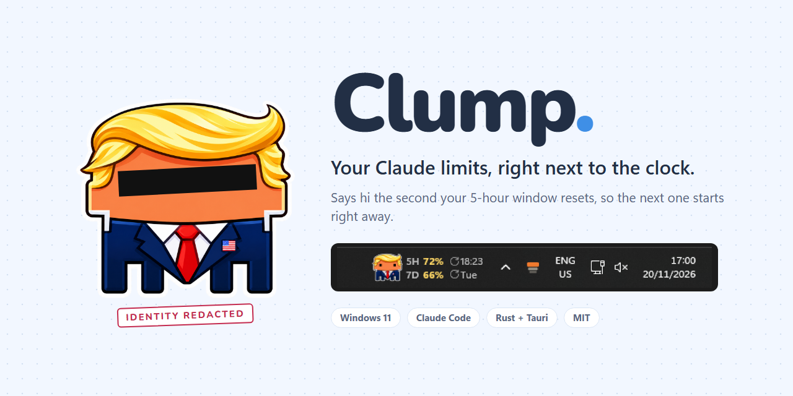
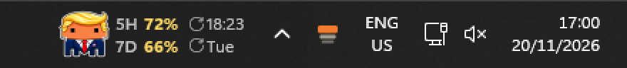
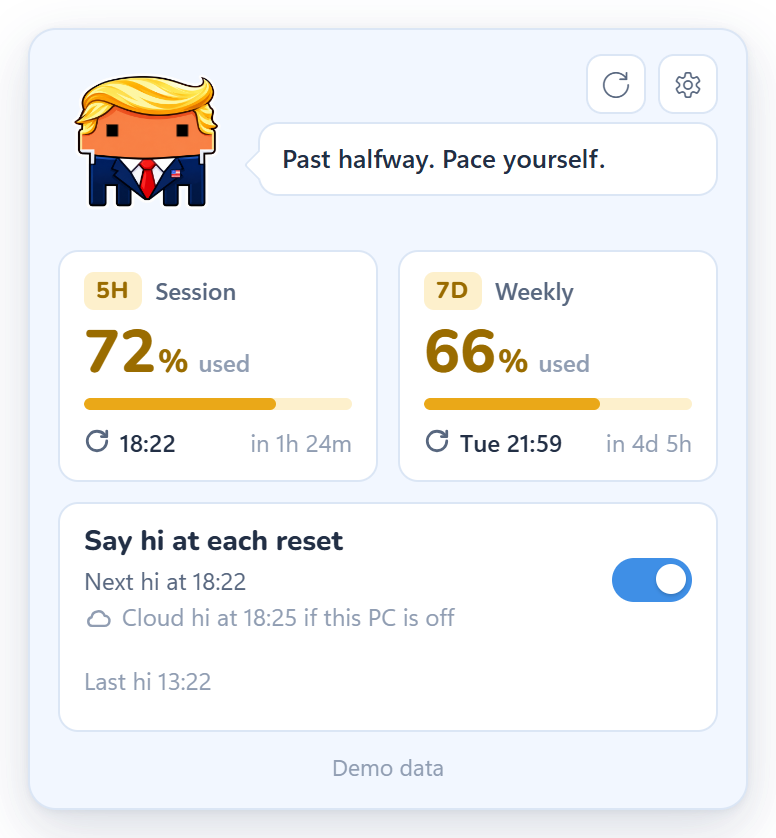
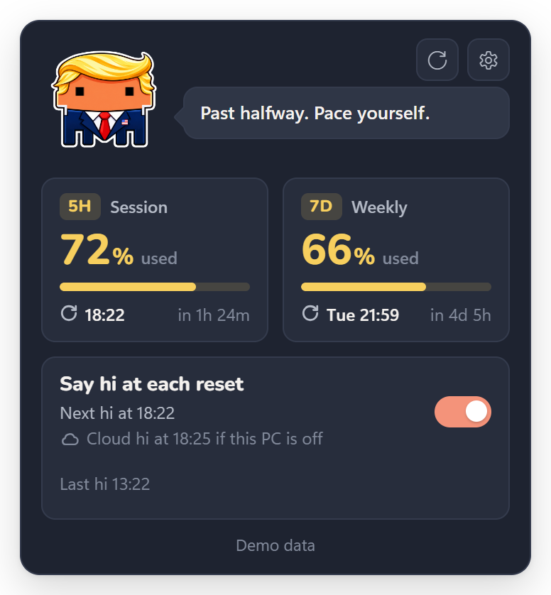
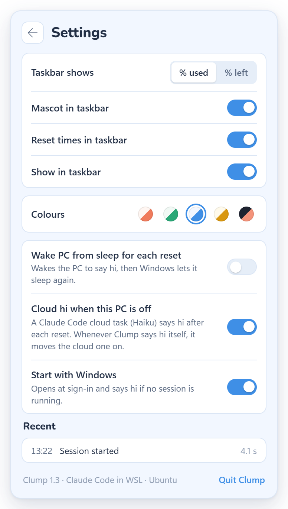

<p align="center"></p>

# Clump

A small Windows taskbar app that shows your Claude limits next to the clock. The moment your 5-hour window resets, it says `hi` through Claude Code, so a new window starts right away.

<p align="center"></p>

## Why it exists

Claude's Pro and Max plans have a **5-hour usage window**. It doesn't start at a fixed time. It starts with the first message you send after the last one ended. That causes two problems:

1. **You run out at the worst moment.** Start at 9:00, burn through the limit by 11:30, and you wait until 14:00. Checking how close you are means stopping to open `/usage`.
2. **Idle time pushes your next reset later.** If the window resets at 14:00 while you're in a meeting and your next message is at 15:10, the new window runs until 20:10 instead of 19:00. Over a day, those gaps add up to hours of lost windows.

Clump fixes both:

- **The limits are always in view:** `5H` (session) and `7D` (weekly) sit in the taskbar, coloured by how much is left.
- **The windows run back to back:** at every reset Clump sends one tiny message (`hi`, on Haiku, about 600 tokens), so the next 5-hour window starts the same second, whether you're at the PC or not.

## Screenshots

| Panel (Sky) | Panel (Night) | Settings |
|:---:|:---:|:---:|
|  |  |  |

All screenshots use `--demo` data.

## What it does

- **Taskbar widget:** `5H` is the 5-hour session and `7D` the weekly limit. Each % is coloured by how much is left: mint at 50%+, yellow at 25–50%, orange at 10–25%, pink-red under 10%. `↻` shows when each one resets. Click it to open the panel.
- **Mascot:** a pixel-art gentleman whose identity is classified (see [The Clump Files](#the-clump-files)). His eyes follow the mood: square eyes that blink normally, a sweat drop when you're low, `> <` and a shake when you're nearly out, sleepy eyes with z's when no session is running, and `^ ^` with sparkles right after a new session. He moves about 12 times a second while you're at the PC and freezes after 2 minutes idle, so he costs about 1% of one CPU core.
- **Panel:** the mascot with a speech bubble, the 5H and 7D cards, *Say hi at each reset*, and Settings: % used or left, mascot and reset times on/off, 5 colour themes (Peach, Mint, Sky, Lemon, Night), wake from sleep, cloud backup, start with Windows, and recent hellos.
- **Tray icon:** the mascot with a status dot coloured by what's left. Menu: Open, Say hi now, Say hi at each reset, Quit.
- **When you're away:**
  - *Wake PC from sleep for each reset* (off by default) sets a wake timer. The PC wakes, says hi, and Windows lets it sleep again.
  - *Start with Windows* (on by default) says hi at sign-in if no session is running.
  - *Cloud hi when this PC is off* (off by default) books four Claude Code cloud tasks ("Clump hi 1–4", Haiku, no tools or connectors) after the next four resets, about 20 hours ahead. They run on Anthropic's servers, so they fire even with the PC shut down. Whenever Clump says hi itself, every booking moves forward, so the cloud only fires when the PC couldn't. It needs a Claude Code cloud environment: if you've never opened [claude.ai/code](https://claude.ai/code), open it once and Clump picks it up within a minute.

The limit belongs to your account, not to one app, so the % includes what you use in Claude Code, the Claude desktop app and claude.ai.

## Before you install

**What it needs:** Windows 11, 64-bit (Windows 10 may work but is untested), and **Claude Code signed in on the same PC**. Every form of Claude Code shares one login, so any of these works:

| You use | Live % | Auto hi |
|---|:---:|:---:|
| Claude Code CLI on Windows or in WSL (official installer, WinGet or npm) | ✅ | ✅ |
| Claude Code in VS Code, Cursor or Windsurf | ✅ | ✅ (with the `claude` the extension ships with, if the CLI isn't installed) |
| Claude Code in JetBrains | ✅ | only if the `claude` command is installed too |
| Only the Claude desktop app or claude.ai | ❌ | ❌ |

**It uses your own login.** Clump stores no account and sends nothing anywhere except Anthropic. It reads the login Claude Code already saved on your PC (`~/.claude/.credentials.json`), and the hi counts against your own plan.

**Read this part.** Clump is **not made by or affiliated with Anthropic**. To show the live % (and for the optional cloud backup), it uses that saved login to call Anthropic endpoints directly. The usage endpoint is the unofficial one behind Claude Code's `/usage`. Anthropic's [terms for Claude Code](https://code.claude.com/docs/en/legal-and-compliance) say third-party tools may not use Claude.ai credentials or session tokens, and that Anthropic may enforce this without notice. In plain words: **your account could be limited for using this. Use it at your own risk.** The hi itself goes through the official, unmodified `claude` command.

## Install

1. Download `Clump_<version>_x64.exe` from [Releases](../../releases/latest).
2. Put it somewhere it can stay, for example `%LOCALAPPDATA%\Programs\Clump\`, and run it. It adds itself to *Start with Windows* from that spot.
3. The exe isn't code-signed, so SmartScreen may say "Windows protected your PC". Click **More info → Run anyway**.

Every release has a `SHA256SUMS.txt` and a build attestation: `gh attestation verify <file> --repo HacanAle/Clump` proves GitHub Actions built it from the tagged source.

## How it works

- **Finding the login:** looks in every WSL distro first, then in your Windows user folder, and uses the login whose token is still valid.
- **Finding `claude` on Windows:** `~\.local\bin\claude.exe` (official installer), then every folder on PATH as Windows has it now (read from the registry, so a CLI installed while Clump runs is found without a restart), WinGet's `Links` folder, npm's `claude.cmd`, and last the `claude.exe` that the VS Code, Cursor or Windsurf extension ships with. While none is found, Clump looks again every minute and the panel says so; a hi that's due but can't go out is listed in Recent instead of being skipped silently.
- **Usage:** `GET https://api.anthropic.com/api/oauth/usage`. The endpoint rate-limits hard, so Clump reads it every 3 minutes (every minute while the panel is open) and honors `Retry-After`.
- **Starting a session:** runs the official CLI with the least it can send:

  ```
  claude -p hi --model haiku --restricted --tools '' --strict-mcp-config \
         --no-session-persistence --disable-slash-commands \
         --system-prompt 'Reply with one short word.' --output-format json
  ```

  That's about 600 input tokens on Haiku and takes about 3.5 s. Your hooks, MCP servers and settings are not loaded, and nothing is saved to your history.
- **Cloud backup:** uses the same endpoints as Claude Code's `/schedule` (`/v1/code/triggers`, `/v1/environments`) in your `Default` cloud environment. Each task is a one-time run that switches itself off after it fires, and Clump re-arms it. A booking that's about to fire is never moved. An empty tool list means "the default tools" to the cloud, so Clump names every tool the server stores for the task in `disallowed_tools` (this also fixes tasks made by 1.3.0). The API can't delete tasks: turn the setting off, then delete them at claude.ai/code/routines. If Clump starts without its `cloud.json` (first run, or its data was deleted) and the setting is off, it switches off any "Clump hi" tasks still on, so none keeps firing with nothing moving it.
- **Expired token:** if Claude Code's token expires (after about 8 h without use), the reset time Clump already knows still triggers the hi, and that also refreshes the token.

## The Clump Files

> **RELEASED UNDER THE CLUMP FILES TRANSPARENCY ACT · PAGE 1 OF 1**
>
> **Subject:** the mascot<br>
> **Name:** ██████ ████ █████<br>
> **Occupation:** sitting in your taskbar, judging your token usage<br>
> **Hair:** ████████████ (yellow, swoop, load-bearing)<br>
> **Known associates:** ████████ ███████, ██████ ████ ██, and one (1) Haiku model<br>
> **Travel records:** ████████████████████████████████████<br>
> **Statement:** *"Nobody resets a session better than me. Nobody. ████ ███ ██████ ███ ███████."*
>
> **Pages withheld:** most of them. **Reason:** ██████ ████████.

Clump's own numbers are never redacted: your 5H and 7D are shown in full, every 3 minutes. Some files can't say the same.

## Files

| What | Where |
|---|---|
| Settings, last reading, history, log | `%APPDATA%\com.clump.app\` (`settings.json`, `last-usage.json`, `pings.json`, `cloud.json`, `clump.log`) |
| Start with Windows | `HKCU\Software\Microsoft\Windows\CurrentVersion\Run` → `Clump` |

## Build

Windows, Rust stable. No Node needed: the UI in `ui/` is plain HTML/CSS/JS, with the Nunito font self-hosted in `ui/fonts/` (SIL Open Font License, see `ui/fonts/OFL.txt`).

```powershell
cd src-tauri
cargo test            # unit tests
cargo build --release # target\release\clump.exe
```

`clump.exe --demo=85` shows fake numbers, sends nothing and touches no network, which makes it handy for screenshots.

To change the mascot, run `python3 tools/make_mascot.py <picture.png>`. It rewrites `ui/mascot.png`, `src-tauri/assets/mascot-160.rgba` and the app icons. If the new picture's eyes sit elsewhere, update `EYES` in `make_mascot.py`, `gauge.rs` and `index.html`.

Releases are built by [`.github/workflows/release.yml`](.github/workflows/release.yml) when a `v*` tag is pushed.

## Uninstall

Turn off *Cloud hi when this PC is off* and *Start with Windows* in Settings, then choose *Quit Clump*. Delete the exe, the `%APPDATA%\com.clump.app\` folder and `%LOCALAPPDATA%\com.clump.app\` (the panel's WebView cache). If you used cloud backup, delete the "Clump hi" tasks at claude.ai/code/routines: they stay on if you delete the data without turning the setting off first and never run Clump again.

## License

[MIT](LICENSE). The Nunito font is under the [SIL Open Font License 1.1](ui/fonts/OFL.txt).
